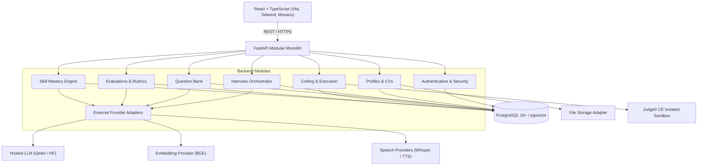

# CareerPilot — System Architecture

## 1. Overview
CareerPilot is an AI-powered technical interview training platform designed for computer science students and recent graduates. It features adaptive questioning, live code execution through Judge0, evidence-based rubric evaluation, and a deterministic **Skill Mastery Engine**.

## 2. Component Diagram

## 3. Core Principles
1. **Explainable Skill Engine**: Explicit DAG prerequisite relationships and deterministic alpha-weighted mastery calculation.
2. **Untrusted Code Isolation**: Candidate code is executed only in Judge0 sandboxes with restricted network and resource bounds.
3. **Traceable Rubrics**: Every report score is backed by recorded evidence turns or flagged as insufficient evidence.
4. **Resilient Provider Fallback**: Text mode fallbacks when voice services or external APIs are unavailable.
