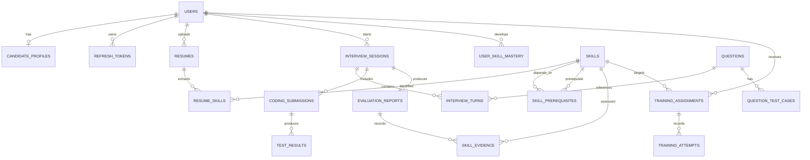

# CareerPilot — Database Entity Relationship Diagram & Schema Specification

## 1. Entity Relationship Diagram

## 2. Table Catalog
1. **`users`**: Canonical credentials, normalized emails, Argon2id password hashes, active flags.
2. **`candidate_profiles`**: Candidate personal details, target role, experience level, preferred language.
3. **`refresh_tokens`**: Hashed rotating refresh tokens with family revocation tracking.
4. **`resumes`**: Private storage references, extraction statuses, and extracted text.
5. **`skills`**: Master taxonomy of technical skills with slugs and difficulty rankings.
6. **`skill_prerequisites`**: Directed acyclic graph (DAG) representation of prerequisite relationships.
7. **`resume_skills`**: Skills extracted from CVs with extraction confidence and source evidence.
8. **`questions`**: Practice and interview question bank with criteria, starter templates, and target roles.
9. **`question_test_cases`**: Public and hidden verification test cases with weightings.
10. **`interview_sessions`**: Session lifecycle tracking (`created`, `in_progress`, `completed`, `abandoned`).
11. **`interview_turns`**: Sequential turns between candidate and assistant.
12. **`coding_submissions`**: Source code submissions with Judge0 execution metrics.
13. **`test_results`**: Granular pass/fail execution metrics per test case.
14. **`evaluation_reports`**: Versioned rubric assessment summary, strengths, and weaknesses.
15. **`skill_evidence`**: Traceable links between rubric items and actual candidate turns or code results.
16. **`user_skill_mastery`**: Real-time mastery scores, evidence counts, and confidence levels.
17. **`training_assignments`**: Targeted practice tasks generated by the Skill Mastery Engine.
18. **`training_attempts`**: Practice completion records and score tracking.
